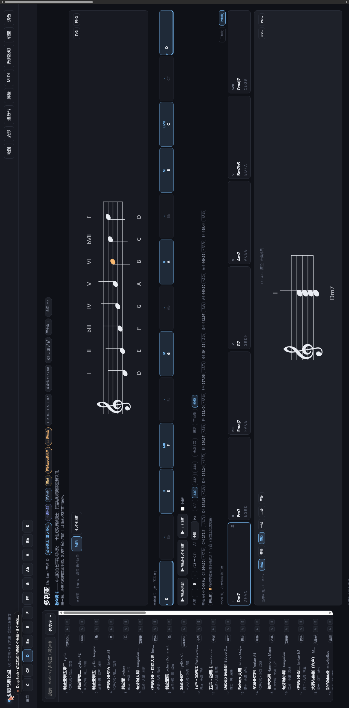

# 幻歌鸟调色盘 · Gengoetori Palette

> 把六十条音阶放进同一个调色盘：看见它的颜色，听见它的和弦，写下来能直接演。

幻歌鸟调色盘是一个**音阶色彩实验室**。它把 Scale Color（音阶的色彩感）和 Scale Chord（音阶自己长出来的和弦）放进同一张桌子：左边 60 条音阶，中间一条音阶的五线谱与七个和弦，下面五个调式邻居，右边一台能直接排进行的钢琴谱。给视唱练耳和作曲入门的人一个**可以反复听、反复比、看得见颜色**的环境。

作者 **TouhouGakurin** · 社团「幻歌鸟与风声之乐」· MIT License



## 能做什么

| | |
|---|---|
| **60 条音阶 × 12 个主音** | 教会调式 / 旋律小调 / 和声小调 / 和声大调 / 那不勒斯 / 爵士与布鲁斯 / 民族与地域 / 对称音阶，八个来源，每条都有出处与性格 |
| **看见颜色** | 大调 / 属 / 小调 / 增三 / 混三 / 无三度 六种色彩分类，按色彩、按来源、按风格、按亮度序都能排 |
| **听见特征** | 特征音染色（跟本位大小调比）、持续主音、播放时逐音高亮、十二平均律 / 纯律一键切换 |
| **看懂和弦** | 七个级数和弦、三 / 七和弦、密集 / 开放排列、四转位；平行调借用与副属和弦可以直接试听 |
| **写下去** | 八槽进行台，每槽可设时值与休止，自带拍号 / 小节线 / 附点 / 延音线；四部和声自动配声并按规矩检错，违规在谱面上打点 |
| **带得走** | 谱面导出 SVG / PNG（自包含）、整页打印成讲义、URL 记住当前状态、导出 `.mid` 拖进 Cubase |

## 三种用法

**1. 网页版（零安装）**：仓库里直接双击 `index.html` 就能用，不联网、不写注册表、不装依赖。

**2. 桌面版（Windows）**：从 [Releases](https://github.com/TouhouGakurin/gengoetori-palette/releases) 下载 zip，解压后运行 `幻歌鸟调色盘.exe`。免安装，自带 Bravura 字体，谱面不依赖系统字体。

   系统要求：Windows 10 1903+ / Windows 11，64 位；需要系统 WebView2 运行时（Win11 与较新的 Win10 自带）与 .NET Framework 4.8（Win10 1903+ 自带）。如果桌面版起不来，下载同一发布页的 `-web.zip`，解压后双击 `index.html`，功能一致、零依赖。

**3. 自己构建（一条命令）**：

```bat
node 发版.mjs            :: 构建 + 跑全部测试 + 打 Windows 包 + 归位到 release\
node 发版.mjs --build    :: 只更新网页版 index.html
node 发版.mjs --fast     :: 跳过测试，快速出包
```

想单独跑某一步：

```bat
node build.mjs                                     :: 把 src/js/*.js 拼进 src/shell.html → index.html
node packaging-webview2\make-webview2.mjs --dist   :: 只打 WebView2 宿主（需要系统 .NET Framework 4.8）
```

发行说明见 [Releases](https://github.com/TouhouGakuRin/gengoetori-palette/releases)。打包与发版流程留在本地开发档案，不随仓库发布。

## 它是怎么算的

- **音阶不是音级表，是一段有出处的语汇**：每条记 `来源 / 旋法 / 风格与色彩感受 / 性质 / 音级`，音级是最后的结果而不是定义。
- **谱面是雕版不是排版**：所有符号用 Bravura（SMuFL）字形，调号按「临时记号最少」自动选，二度和声音程按规范错开，加线各画各的。
- **四部和声是搜索不是套模板**：整条进行按最短路做 DP，硬规矩（平行五八、隐伏五八、导音与七音解决、间距）压过一切软偏好。
- **五声的拼写照宫走**：商调式在 C 上写成 `C D F G Bb`，不是 `A#`。

## 测试

十一套、113 个断言，全部离线：

```bat
node tests\core.test.mjs     node tests\key.test.mjs      node tests\staff.test.mjs
node tests\state.test.mjs    node tests\satb.test.mjs     node tests\rhythm.test.mjs
node tests\map.test.mjs      node tests\deck.test.mjs     node tests\ear.test.mjs
node tests\borrow.test.mjs   node tests\settings.test.mjs
```

## 许可与致谢

- **代码与文档**：MIT License，见 [LICENSE](LICENSE)。
- **图标（另外一套许可）**：夜雀／米斯蒂娅·罗蕾莱与萨克斯，画师 **小旗**，是**基于《東方Project》的二次创作（同人图）**。原作 **東方Project © 上海アリス幻樂団（Team Shanghai Alice）／ZUN**；本软件不是官方作品，与其无隶属或授权关系。图片**不**适用上面的 MIT 许可，条款见 [assets/LICENSE-ICON.md](assets/LICENSE-ICON.md)，并遵循官方[二次创作指南](https://touhou-project.news/guideline/)（[English](https://touhou-project.news/guidelines_en/)）。
- **谱面字体**：**Bravura**（Steinberg Media Technologies GmbH），SIL Open Font License 1.1，见 [fonts/LICENSE-Bravura.txt](fonts/LICENSE-Bravura.txt)。
- **谱面规则依据**：《音乐曲谱出版规范》中的连谱号、调号、加线、二度音程等条款。

---

## 详细手册

下面是从第一版写到现在的手册与版本记录，按时间倒序排列，适合想改代码或想弄清每个开关的人。


## 界面

- **顶部主音条**：12 个键，点一下全表重算。
- **左栏调式库**：60 个音阶（33 个七声调式 + 27 个多声音阶，含十二声半音阶）。搜索支持英文名、中文名、听感标签（如「凯尔特」）；右上角可切换「亮度序 / 按色彩 / 按来源 / 按距离」。每行右侧 `A` `B` 按钮决定它是对比中的哪一侧；名字后面那个 `大` / `小` 是本调式的色彩分类。
- **中间**：
  - **五线谱**（就在标题下面，跟着当前调式实时重画）：两种视图，「音阶」排七级 + 高八度主音，「七个和弦」把每级的密集排列竖着叠出来。调号随主音与调式自动变。
  - 半音槽位 13 格（主音 → 高八度主音），音阶内的格子亮起并标出级数（`bIII`、`#IV`），点一下发声；最后一格是真·高八度（比主音高 12 个半音），点它听到的就是高八度的主音；
  - 七个和弦卡（在音阶内叠三度得出），点卡听和弦；标题右边和进行台各有一个 `三和弦 / 七和弦` 切换，两边联动，卡、谱、试听、MIDI 导出全都跟着变（三和弦时大和弦写作 `C`、属和弦写作 `G`）；
  - **选中和弦的单独一行谱**：点哪张卡，下面就画哪张卡的谱（播放「七个和弦」时也会跟着走）。谱面上方有两组开关，**就近在谱子旁边**：
    - `密集 / 开放`：密集 = 三度叠置挤在一个八度内；开放 = 低音不动、上方声部隔一个和弦音往上叠（根位时就是 C4 G4 E5 B5 这种教科书式的开放排列），听感更开阔。
    - `原位 / 一转 / 二转 / 三转`：把第几个和弦音放到低音；三和弦只有一转、二转（三转按钮会自动禁用）。设成转位后，和弦名会写成斜杠形式（`Cmaj7/E`、`G7/D`），谱面、试听、`和弦.mid` 都跟着变。
    - 两组开关都会记忆（localStorage），点按钮时会立刻发声，方便 A/B 对比。
  - 「播放音阶 / 播放七个和弦 / 主和弦」，可切「分解」；
  - **声音那两行**：`八度 −/+` 整体升降八度（±2，试听、进行台、导出的 .mid 一起走）；`A4` 可调参考音频率（400–480 Hz，带 432 / 440 / 442 / 444 快捷键），下面一行实时列出当前八度十二个音的实际频率（十二平均律，`f = A4 × 2^((n−69)/12)`）；
  - 最接近的三个调式，点一下就跳过去。
- **底部 A/B 对比**：距离分、共同音、双方独有音、各自主和弦，还有「试听差异」（先 A 主和弦，再 B 主和弦，最后把差异音逐个弹出）。
- **调式地图**：33 个节点，位置由**多维标定（MDS）**算出——把 33×33 的「调式距离矩阵」压进二维平面，所以图上两点间的远近，就是它们真实音高集合的远近（当前 stress 0.28，图中距离与真实距离的皮尔逊相关 **+0.71**，越接近 1 越忠实）。每次打开位置完全一样（黄金角螺旋起点，无随机数）。
  - **选中即居中**：点节点、点左栏、点最近邻、按 ← →，任何一个入口切换调式，相机都会在 380ms 内平滑移到它身上，让被选中的调式永远停在画面中心。
  - **向量分布**：选中后，到邻居的连线变成带箭头的向量，箭头旁标着距离分（`2` = 只差一个音，`2.5` = 差一个音 + 三全音位不同）；同时画出 2 分、4 分两圈虚线等高线，一眼能看出「谁离它一圈、谁离它两圈」。
  - 颜色按来源分（中古 / 旋律小调 / 和声小调 / 和声大调 / 补充）；标签带撞位避让，几乎同位的调式（如 `Mix b2` 与 `Mix b2′`）不会叠字。
- **变形滑杆**：七个级各有一对 `−` `+`，每次移半音，右侧实时显示「现在等于哪个调式」；不匹配任何已收录调式时，给出最近的那条与距离。切换调式会自动还原。
- **听辨测验**：从 21 条主表调式里随机抽一条 + 随机主音，听音阶与主和弦，四选一；答完显示正确答案、主音与音阶公式，并记分。
- **导出 MIDI**：把当前调式导成 `.mid`（格式 0，480 TPQ，通道 1）。「音阶」= 7 音 + 高八度主音；「和弦」= 七个和弦各 2 拍；「音阶 + 和弦」= 两者接起来。拖进 Cubase 换音色即可。
- **五线谱的记谱规则**：
  - 调号跟着主音与调式走：C 伊奥尼亚无升降，切到 Eb 立刻 3 个降号；Eb 和声小调是 6 个降号 + 还原的 D 上补 `♮`。
  - 调号按「临时记号最少」自动选，与调号冲突的音才画临时记号（橙色），不会每个音都标一遍。
  - 音高位置由「字母 + 八度」算，所以 C4 在谱下方加一条加线、B4 开始换朝下的符干，都按谱面规则自动处理。
- **大调色彩 / 小调色彩**：看第三级——大三度就是大调色彩（伊奥尼亚、利底亚、混合利底亚、和声大调…），小三度就是小调色彩（伊奥利亚、多利亚、弗里几亚、和声小调、洛克里亚…）。主调式标题上有一个徽章，左栏每行有个 `大`/`小` 小标，下拉切「按色彩」会把 33 条按这两类分开列。
- **进行台**：八个槽位。把下面的和弦卡拖进槽位，或者直接点卡片自动补到第一个空位；已填的槽位可以互相拖动换顺序，双击清空。`播放` 按钮点一次开始、再点一次立刻停（循环时也一样），播放结束会自动复位。工具栏上有拍号（4/4 · 3/4 · 2/4），每个槽位可以单独设时值（1–8 拍）或改成休止，槽位下方同步画出这条进行的**实际乐谱**（拍号、小节线、附点、休止符、跨小节延音线），导出的 `.mid` 用的也是同一套时值。

## 键盘

- `空格`：播放当前调式的音阶
- `←` `→`：在 33 个调式之间切换
- `Esc`：关闭弹窗

## 数据约定

每条音阶记的是**它从哪来**和**它在音乐语言里是什么性格**，音级本身只是最后一项：

| 字段 | 意思 | 例 |
|------|------|----|
| `src` | 来源（8 个体系之一） | `church` 教会调式 / `jazz` 爵士与布鲁斯 / `folk` 民族与地域 |
| `rot` | 在该体系内的旋法号 | 多利亚是教会调式的第 2 旋法 |
| `traits` | 人在音乐语言里的说法（2–3 条） | 「小三度与增二度」「小调功能和声的母体」 |
| `about` | 一句话出处与性格 | 「升高七级让属和弦有导音，代价是增二度」 |
| `pcs` | 相对主音的半音集合（0=C） | 和声小调 `[0,2,3,5,7,8,11]` |
| `colorKey` | 色彩（由三级与七级推出，五声按旋宫定） | `M` 大调 / `m` 小调 / `D` 属 / `A` 增三 / `X` 混合 / `x` 无三度 |

音名、级数、和弦、距离这些全部**推导**出来，不单独存：

- **音名**：按字母顺序逐级拼写，所以 Eb 大调写出来是 `Eb F G Ab Bb C D`，不会变成 `D# F G G# A# C D`。
- **级数**：相对同主音大调。所以 Lydian #2 的第 2 级是 `#II` 而不是 `bIII`；Eb 大调的一级就是 `I`。
- **和弦**：`pcs` 内每隔一音叠三次，性质由音程集合查表得出（maj7 / 7 / m7 / m7b5 / dim7 / mMaj7 / maj7#5 …）。
- **距离**：`A 独有 + B 独有 + 0.5×三全音数差 + 0.5×主和弦性质差异`，再换算成 0–100。

## 八个来源

| 来源 | 条数 | 说明 |
|------|------|------|
| 教会调式 | 7 | 中世纪七声调式体系，二十世纪后被爵士、民谣与影视配乐重新采用 |
| 旋律小调体系 | 7 | 爵士里最常用的「旋律小调七个旋法」 |
| 和声小调体系 | 7 | 小调功能和声的母体，含增二度 |
| 和声大调体系 | 7 | 大调降六，第三旋法就是增五度的「增三色彩」 |
| 那不勒斯与降二 | 3 | 降二级为核心的调式，那不勒斯六和弦的母体 |
| 爵士与布鲁斯 | 6 | 布鲁斯、大调布鲁斯、bebop、属升四 |
| 民族与地域 | 11 | 中国五声旋宫、日本都节/平调子/岩户、匈牙利、拜占庭、拿波里 |
| 对称音阶 | 12 | 全音、增、减、梅西安 3–7、半音阶 |

列表可按「来源」分组（组标题带英文名）、按「色彩」分组、按亮度序或按与当前调式的距离排。

## 版本计划

- **v2 已完成**：调式地图 + 变形滑杆。
- **v3 已完成**：听辨测验、MIDI 导出。
- **v4 已完成**：五线谱（音阶 / 七个和弦两视图）、进行台（拖拽 + 谱面 + 循环播放 + 导出）、键盘快捷键。
- **v5 已完成**：五线谱搬进首页（贴着调式标题与和弦卡）、选中和弦单独一行谱、调号随主音实时变、大调/小调色彩分类与按色彩排序。
- **v6 已完成**：三和弦 / 七和弦切换（卡、谱、试听、MIDI 联动）、进行台播放/停止可切换（修了不能主动停的 bug、停止后残留的高亮定时器）。
- **v7 已完成**：八度整体切换（±2，试听与 MIDI 同步）、高八度主音格真的发出高八度、A4 参考频率可调并实时换算十二平均律十二个音的 Hz。
- **v8 已完成**：和弦的开放式 / 转位排列（开关就在选中和弦那行谱的标题旁），谱面与试听同步，和弦名自动写成斜杠形式；进行台、测验、A/B 对比仍按原位密集播放（它们是独立的声音，不受这个开关影响）。
- **v9 已完成**：五线谱排版加了避让——相邻二度的符头自动错到符干另一侧（转位、开放排列里最常见的重叠），加线改成整个和弦共享一条、临时记号太挤时会再往左让一列；顺带把工程拆成 `src/` 源码 + `build.mjs` 零依赖拼接器（详见 PLAN.md，产物仍是单文件 `index.html`）。
- **v9.1 已完成**：core 层抽成 5 个纯函数模块（拼写 / 调式数据 / 和弦 / 理论 / MIDI），配 9 个测试与 396 行 golden 基线。改完跑 `node tests/core.test.mjs`，绿了再 `node build.mjs`。

- **v9.2 已完成**：状态与音频也拆出去了——`05-store.js` 管「改值 + 持久化 + 通知」（六种偏好现在只在一张表里登记），`10-audio-engine.js` 把「弹什么」拆成可测的计划（`planScale` / `planChord` / `planDegree`）和一层薄薄的 WebAudio 壳。

- **v9.3 已完成**：`50-legacy.js` 删了。渲染改成「注册表 + 按序管线」：每个视图一个文件、末尾 `uiRegister(id, render)`，`renderAll()` 按 `UI_ORDER` 逐个调用并用 try/catch 兜住（单个视图抛错不会再让整页空白）。事件与 init 收进 `60-main.js`，`switchMode()` 成为换调式的唯一入口。22 个模块、最大 11.6 KB；9 + 3 + 12 个测试全绿。

## 中国五声：旋宫 + 偏音（v11）

「五声」在库里只有一条，不再是宫商角徵羽五条并列。选中它时，标题下面会多出一条**只有它能看见**的选项带：

- **旋宫**：宫调式 / 商调式 / 角调式 / 徵调式 / 羽调式 —— 同一组音换个主音，五线谱的阶名、和弦卡、变形滑杆会一起重排（五声的每个角度都是合法的调式，所以在旋法上它就是「内部的转位」）。
- **偏音 · 清角一侧**：无 / 清角（+5）/ 变徵（+6）
- **偏音 · 变宫一侧**：无 / 闰（+10）/ 变宫（+11）

偏音一插，音阶立刻变成 6 声或 7 声：例如「商调式 + 清角 + 变宫」= C D E♭ F G A B♭，正是七声清乐的商调；阶名仍然写宫/商/角/清角/徵/羽/变宫，不会退回罗马数字。和弦卡按新的音集重算（例：清角上的和弦是 E♭maj7）。

这些按钮用 `state.rot5 / b4 / b7` 三个字段存，切到别的音阶就整条隐藏，不留痕迹。

### 和弦构成：三度 / 五度（v11.1）

五声音阶的和弦有两种算法，在同一个选项带的最后一组里切换：

- **三度叠置**（默认）：在音阶内隔一音叠三度。宫上得到 C–E–A，标 `C(M3·13)` —— 五声缺一个音，三度叠出来会「少一层」，所以名字不好看但音是对的。
- **五度叠置**：沿五声纵合链 宫→徵→商→羽→角 取相邻音。宫 = C G D（`Csus2`）、商 = D A E（`Dsus2`）、角 = E C G（`Em(#5)`）、徵 = G D A（`Gsus2`）、羽 = A E C（`Am`）—— 这一组才是五声的和声本色。

叠几个音由右上角的 `三音 / 四音` 控制（五度叠置时这个开关自动改名，它只管叠几个音，不再是「三和弦 / 七和弦」）：

- 三音：宫 C G D、羽 A E C（Am）
- 四音：宫 C G D A（`Csus2+`）、羽 A E C G（`Am7`）、商 D A E C（`D7sus2`）

插了偏音（6 声 / 7 声）之后，五度链上多了外音、纵合的定义就不成立了，所以那一组按钮会自动收起，和弦按三度叠置算。

## 版本记录

- **1.1.4**（2026-10-30）便携兜底：数据根默认落在 exe 旁的 `userdata\`，不再依赖 `%LOCALAPPDATA%`——被组策略锁死用户目录的机器也能跑；日志在主目录写不进去时退到临时目录；同版本附带纯网页包（零依赖）。
- **1.1.3**（2026-10-30）数据根按 LocalAppData→AppData→Temp 逐级回退，直接显示 mkdir 的真实错误码，弹窗消息修成正常换行。
- **1.1.2**（2026-10-30）启动更抗错：数据目录先建、失败重试、逐条报出尝试过的位置；提供临时日志与 `--fresh-profile` 逃生口。
- **1.1.1**（2026-10-30）数据与备份：设置面板新增「数据与备份」，显示数据实际位置（便携目录/用户目录/网页浏览器），可一键导出备份 JSON、导入恢复、只清本程序数据；备份带格式与版本校验，坏文件与未来版本一律拒绝；网页版提示"数据在本浏览器"。-
- **1.1.0**（2026-10-30）布局与便携：顶部改成"模块路由"（音阶/对比/地图/变形/进行台/测验/MIDI，Alt+1…7），一次只显示一个模块，音阶库常驻；窄窗下音阶库变抽屉；主音条与模块条常驻，滚动时不再丢失调性；小窗口优先于大字号。桌面版改为**便携优先**：exe 旁有 `userdata\` 或 `portable.txt` 时，设置、进行台、日志、WebView2 数据全部写在该目录；窗口尺寸会夹进工作区，高 DPI 下不再出屏；每次导出的目录与上次相同。记忆范围补齐：重启后保留音阶、主音、和弦；进行台存盘带主音，移调打开会提示。分享链接覆盖外挂和弦、四部/两行设置与进行台，旧链接仍可读。设置面板与页脚显示版本号。
- **1.0.2**（2026-10-27）高分屏修复：外壳加 PerMonitorV2 清单 + 进程 DPI 感知 + 尺寸按 DPI 换算；深色标题栏与圆角；关掉 WebView2 的默认右键菜单。
- **1.0.1**（2026-10-26）声音修正：音符时值缩短（音阶 0.34 s/音）、新播放先淡出旧音再响，连点不再叠成一团。
- **1.0.0**（2026-10-26）定名发版：幻歌鸟调色盘 · Gengoetori Palette，图标换成夜雀与萨克斯（画师 小旗，東方Project 同人二次创作），WebView2 宿主 93 KB。
补充

- **v11.1**：五声加「和弦构成」开关（三度叠置 / 五度纵合），五度叠置时三/七和弦开关改叫三音/四音。
- **v11**：五声合并为一条「中国五声（五调）」，加旋宫（5 个调式）与两组偏音选项；阶名支持「宫商角徵羽 + 清角/变徵/闰/变宫」；带偏音的七声不再显示「相对大调」徽标，改显示「7 声（含 2 个偏音）」。总数 60 → 56。

## 来源合并与五声分开（v11.2）

「来源序」现在是 10 个族，民族音乐统一收进一个 **民族** 组（20 条）：中国五声五调、日本三调、Bebop 四调、梅西安五调、西班牙与吉普赛调式都在里面。原来的「五声 / Bebop / 梅西安」三个族名不再单独出现。

但「亮度序」和地图没有合并：中国五声从一条拆回 **五条真实条目**（宫 / 商 / 角 / 徵 / 羽），所以

- 亮度序里五声占五行，各自排在自己的位置；
- 调式地图里是五个独立的点，节点标注就是「宫、商、角、徵、羽」；
- 标题下的「旋宫」五个按钮现在等于**切换选中的音阶**——点「徵调式」，列表高亮、五线谱、和弦卡、地图镜头会一起跳到徵调式，不再只是给宫调式加个偏移参数。

偏音（清角 / 变徵 / 闰 / 变宫）仍然只作用在当前选中的那个五声调式上，旋宫会把偏音带到新调式（同一个绝对音高集合）。

## 亮度序：一把尺子量 60 条（v11.4）

以前只有七声调式有亮度序号，其余按音数被挤在列表末尾。现在全部按同一个标准算分：

**亮度 = 相对同主音大调的变化音数**（升记 +1，降记 −1）。

- **七声**：第 i 个音与大调第 i 级的差，逐级相加。这和界面上标的 `#4`、`b7` 是同一个口径。
- **非七声**（五声 / 六声 / 八声 / 九声 / 十声 / 十二声）：按最近的 Ionian 级数取偏差；正好卡在两级正中间的（b2 / b3 / b5 / b6 / b7）一律按降号算。于是五声·宫 = 0（与自然大调同分）、五声·角 = −3（与伊奥利亚同分）、Bebop 属 = −1（与混合利底亚同分）。
- 同分时按 id 排，所以每次打开顺序一样。

几个参照点：

| 音阶 | 分数 | 位次 |
|---|---|---|
| 利底亚增五增二 | +3 | 1 |
| 利底亚 | +1 | 5 |
| 伊奥尼亚 · 自然大调 | 0 | 7 |
| 五声 · 宫调式 | 0 | 9 |
| 混合利底亚 / Bebop 属 | −1 | 12 / 14 |
| 伊奥利亚 / 五声 · 角调式 | −3 | 37 / 47 |
| 超级洛克里亚 · 变化 | −6 | 58 |
| 超级洛克里亚降七 | −7 | 60 |

已知的粗糙处：音高集合分不出 `b4` 与 `3`、`bb7` 与 `6`，所以极少数对称音阶（如梅西安式）会差一格；半音阶算 −5，排在中下。

## 调式地图：拖拽与缩放（v11.5）

地图现在是一张可以拖着看的地图，不再只显示一个固定视口：

- **滚轮缩放**：0.65× – 3.4×，以鼠标指针下的那个点为中心放大/缩小，不会跑偏。
- **按住拖动平移**：鼠标按下后移动 4px 以上才算拖拽，松手时不会误触节点；光标会变成抓手。
- **双击复位**：双击画面 = 缩放回 1× 并把当前选中的调式重新放到正中。
- **点节点仍然切换调式**，缩放、平移都不影响。

实现上做了两件事，否则缩放会很难看：

1. **几何随缩放走，标记不随缩放走**。节点组带 `scale(1/zoom)`，圆点、短名、距离标签在任何缩放下都是同一个视觉大小；连线和箭头的 `vector-effect="non-scaling-stroke"` 保证线宽永远是 1px。否则放大三倍后一个点会变成脸盆那么大。
2. **相机记的是中心点 + 缩放倍数**（`mapState.cx/cy/zoom`），`viewBox` 每次由它算出来；平移时把边界夹在世界范围内，拖不出空图。

### v11.5 修：点击失效

第一版用了 `setPointerCapture` 来保证拖出画框也能继续拖，结果它把随后的 `click` 重定向到 `<svg>` 本身，节点上的监听器永远收不到——表现为「点节点没反应」。改成在 `window` 上挂 `pointermove / pointerup`（拖出画框照样有效），不碰指针捕获。

同时两处手感修正：

- 每个节点加了一个 `r=15` 的透明命中圈，点标签文字、点圆点边缘、点旁边几像素的空白都能选中（原来只有 6 半径的圆面能点中）。
- 拖拽阈值从 4px 放宽到 7px：手抖几像素不会把点击判成拖拽。

## 进行台：任意和弦（v12）

每个槽位不再只存「第几级」，而是一个和弦配方：**来源音阶 + 级数 + 音数**。

- **音数 2–7**：二音 / 三和弦 / 七和弦 / 九和弦 / 十一和弦 / 十三和弦。上限跟着音阶走（五声最多 5 个音，七声 7 个，半音阶也按 7 封顶）。
- **来源音阶**：60 个音阶任选，可以「跟随当前音阶」（改主调式时它跟着变），也可以钉死某一个——比如第 3 槽固定用和声小调的 V。
- 和弦名自动拼：骨架（maj7 / m7 / 7 / m7b5 …）+ 括号里的延伸音（`9` / `11` / `13` / `#11` / `b9` / `b13`）。查不到骨架时退回音程写法，例如 `G(m3·11)`。

交互：点下面的和弦卡补到空位 → 点槽位选中 → 上面出现编辑器（来源音阶下拉、级数一排、音数一排、试听、删除）。拖动换顺序，双击清空。整条进行会存进 `localStorage`，刷新还在。

导出与播放都跟着每个槽位自己的配方走：播放按各槽的音数叠音，导出的 `.mid` 也是——7 音和弦就是 7 个 note-on。

一个副作用值得知道：槽位如果选了别的音阶，五线谱的调号仍按当前主调式算，所以跨音阶的和弦会带临时记号（截图里 `G7(b9·11)` 的 b9 就写成 ♭ 号）。这是有意的——调号跳来跳去反而更难读。

## 每个槽位自己的转位与排列（v12.1）

以前「密集 / 开放」「原位 / 一转 / 二转 / 三转」是全局设置，只作用于选中和弦那张卡。现在它们下放到**每个槽位**：点开任一槽位，编辑器里多出「排列」和「转位」两组按钮，改了只影响这一槽。

所以同一个和弦在一次进行里可以出现两次、一次原位一次转位——声部移动才写得出来。转位的选择范围跟着音数走：三和弦只有两个转位，四音和弦三个。

## 四部和声（v13 起步）

进行台右上多了一个 **四部和声** 开关。打开后：

- 每个槽位的和弦被摊成 **S / A / T / B** 四个声部，五线谱换成大谱表（高音谱放 S、A，低音谱放 T、B），左侧有连谱号。
- 声部写在各自的常用音域里（S 60–81、A 55–74、T 48–67、B 40–62），保证 S > A > T > B 不交越；三音、七音尽量不重复，优先重复根音，四音和弦常常省掉五音。
- 槽位里的**转位仍然决定低音**：选二转，四部和声的低音就落在五音上。
- 整条进行是**一起排的**，不是逐个和弦各排各的：`satbSequence` 会给「平行五度 / 平行八度 / 隐伏八度」加罚分，宁可让某个声部多走一步，也不让两个和弦之间出现平行五八。
- 下方提示行会报出仍然存在的平行（例如「1→2 平行五度（S/B）」），查不到就写「没有查到平行五/八度」。

播放和导出的 `.mid` 都是四声部（每槽 4 个 note-on）。四部和声下「排列」（密集/开放）不再起作用——四声部本身就是一种固定织体。

**这一版还没做的**（说清楚免得误会）：只查平行五八与声部交叉，没有查隐伏五八的全部情形、没有查导音解决、没有查和弦外音与转位标记是否规范，也不会自动改写不合法进行——它只是把你写的进行摊成四部并报出明显问题。真正的四部和声写作训练（给低音配和声、给旋律配和声）是下一步。

## 五线谱：真正的雕版渲染（v14）

以前谱面是「用椭圆 + 直线硬画」，所以怎么调都不像谱子。现在全部换成 **Bravura**（SMuFL 标准字体，Dorico 自带的那一套）：

- 谱号、符头、符干、加线、升降还原记号、调号，**每一个都是 Bravura 的字形**（`gClef` U+E050、`noteheadBlack` U+E0A4、`accidentalSharp` U+E262 等），不是画出来的形状。
- 线宽按 SMuFL 的 engravingDefaults：谱线 0.13 sp、符干 0.12 sp、加线 0.16 sp、加线外伸 0.4 sp、符干长 3.5 sp。
- 1 sp = 10 个内部单位，字号 40（=4 sp），所有尺寸都从「一个间」推导，换字号整谱等比缩放。
- 降号的垂直位置单独校准过：Bravura 的 ♭ 墨迹重心在基线上方 0.52 sp，但雕版要的是「碗」压在音符位置上，所以只下移 0.1 sp（这个数是拿 canvas 量 actualBoundingBox 得到的，不是猜的）。
- 大谱表左侧是**花连谱号 + 连谱线**（规范 1.2.2）：Bravura 的 `brace`（U+E000）竖拉到两行谱表的外框、横向放宽到 1 sp，紧贴在一条贯通两行的细纵线（连谱线）左边。两行共用调号位置规则（低音谱的调号比高音谱低 14 个半音位）。

浏览器直接用系统已安装的 Bravura，不需要内嵌字体文件（Dorico 装过就有）。如果换了台没装 Bravura 的机器，会退回 serif 显示成豆腐块 —— 这是目前唯一的部署依赖。

## 谱面碰撞与拼写（v14.1）

这一版解决的是「音符和记号挤在一起」的问题，根子在**拼写**而不在排版：

- **和弦音按三度拼写，遇到音阶自带写法更省临时记号时改用音阶写法**。例如大调布鲁斯的 I 级写成 **C–E♭–G**（不是 C–D♯–G），因为后者在谱面上会造出一个假的二度，符头和升降号必然打架；而同一音阶 III 级的和弦写成 **D♯–G–C**，因为 D♯ 是音阶本音，硬按三度会拼出 F×（重升）。规则是「谁用的临时记号少用谁，平手取三度拼写」。
- **升降记号不再固定贴在主列左侧**，而是逐个判定：先贴自己符头左边，碰到任何符头或前一个记号就往左挪一列，最多 12 列。这样即使和弦里有真二度、或者两个记号高度接近，也不会叠在一起。
- **二度错开量改成一个符头宽以上**（1.3 sp），两枚符头之间留 0.12 sp 的缝，不再粘成花生。
- 加线（ledger）按错开后的整个和弦宽度画，不会只盖住主列。

和弦卡、选中和弦的谱、进行台的谱共用同一套拼写，所以卡片上的音名和谱面永远一致。

## 谱面按《音乐曲谱出版规范》重排（v15）

逐条对照规范改的，条款号直接标在下面：

- **二度和声音程（1.9.4.1）**：下面的符头总在符干左侧、上面的符头总在符干右侧。以前是「把低音踢到另一边」，符干和符头之间留出 1.1 个符头的空档；现在改成把**需要跨过符干的那一枚**推过去，符干正好从两枚符头之间穿过。连着三音以上的音簇按 1.14.3.5 上下交替。
- **加线（1.1.4.2）**：除相邻二度可共用一条外，其余各画各的。以前整组共用一条长线，跨八度的和弦会拉出一条假线；现在按音级分组，每条只盖住落在这一级的符头。
- **间距随记号数量伸缩**：一组和弦要几个临时记号，就给它多宽的位置。半音阶这种每级 2–4 个记号的谱面因此不再挤成一堆。
- **一行放不下就折行**：单谱表超过 8 组自动分成多行（`drawRows`），半音阶十二个和弦现在是两行，而不是把整张谱缩到看不清。
- **进行台改成钢琴大谱表**：右手弹完整和弦（高音谱），左手弹根音（低音谱），左侧是花连谱号 + 连谱线，和弦名写在低音谱下方。四部和声开关打开时，同一张大谱表改成 S/A 在上、T/B 在下。

## 进行台的节奏（v16）

到 v15 为止，进行台画的还是「音高陈列」：没有拍号、没有小节线、每个和弦都等长。v16 把它变成真乐谱。

- **拍号**：工具栏上的 `4/4 · 3/4 · 2/4`，选了就整张谱跟着变，存 `mlab-deck-meter`。
- **每个槽位有自己的时值**：1／2／3／4／6／8 拍，写成四分、二分、附点二分、全音符……长到跨小节时，按小节线切成几片、片与片之间补延音线（切口处的附点只准出现在小节头，全音符只准占整小节）。
- **槽位可以是休止**：休止也占时间，所以「V – 休止 2 拍 – I」的第二小节开头真的空着，后面的和弦不会被往前挤。整小节休止用全休止挂第四条线，二分休止坐在中线上；休止符不用附点值（3 拍休止写成 二分＋四分）。
- **小节线是等距的**：每拍宽度固定（比例记谱），小节线不额外占宽，所以 4/4 的每个小节恒等宽；终止线是细＋粗。
- **一行放不下就在小节线上折行**，不缩字号 —— 八个小节会排成两三行，跟印刷谱一样。
- **播放和导出都按真时值**：播放速度读 MIDI 区的 `96`（`#midiBpm`），导出的 `.mid` 里 `t = 起点拍数 × TPQ`、`d = 时值 × TPQ × 0.95`。

## 非七声调号、四部和声规矩、地图避让（v17）

### ① 五声、布鲁斯、全音阶也挂调号了

以前的规则是「非七声一律不给调号、全部显式写升降号」；v17 按拍板的办法改成**以调式根音为准 + 大小调色彩**：

- **宫、商、徵按大调，角、羽按小调**。五声的旋宫（`pentRot` 0–4）直接决定色彩。
- 其余非七声音阶按三度定色彩：只有大三度→按大调，只有小三度→按小调，两者都有按名字判，都没有按亮度分。
- 调号 = 主音那个调的调号（C＝0、D＝2♯、E♭＝−3……），小调色彩再借三个降号的关系小调。
- 七声音阶不受影响，仍按原来「临时记号最少」的老办法。
- 好处一眼能看出来：五声·商调式（主音 D）从「没有调号 + 一堆升号」变成「2 个升号 + 一个还原号」；大调布鲁斯在 E♭ 上从 9 个记号降到 3 个降号（只有 G♭ 还带记号）。
- 谱面下方的说明会写「调号 3 个降号 · 按大调」，说明这个调号是借哪一边的。

### ② 四部和声：写作与显示都按规矩来

配声（写作）和提示（显示）现在看同一套规则：

| 规矩 | 怎么判 | 罚分 |
|---|---|---|
| 平行五度 / 平行八度 | 任两声部同向同度进行 | 140 |
| 导音未解决 | 外声部（S、B）的导音没上行小二度到主音 | 120 |
| 间距过大 | S–A、A–T 超八度，T–B 超十二度 | 100 |
| 七音未解决 | 和弦七音没下行级进（除非它还是新和弦的音） | 80 |
| 三全音跳进 | 某声部旋律走增四/减五 | 30 |
| 隐伏八度 / 隐伏五度 | 外声部同向 + 高音跳进进入纯八/纯五 | 20 / 16 |

- **自动配声从贪心换成动态规划**：以前每槽只看前一个和弦，V→I 处经常写出平行八度；现在整条进行一起求最小代价，普通进行能做到零违规。
- 提示行会给汇总与明细：「⚠ 3 处：平行八度×2、导音未解决×1」，后面跟「2→3 平行八度（S/B·两声部同向进到纯八度）」这样的前六条。干净时显示「没有查到平行/隐伏五八、导音与七音问题」。

### ③ 调式地图：60 个节点不再互相压

- **节点**：几乎重合的点对（两个调式只差一个音）会被轻轻推开到至少 30 个单位，其余位置不动 —— 「位置≈距离」的意思还在。
- **标签**：每个标签有 12 个候选位（正下、正上、更下、更上、左右、斜下、斜上、更远两档），先摆选中的、再摆周围最热闹的；节点圆本身也算障碍，标签不会压到别的点。实在没位置就挑压得最少的那个。
- 实测 0.65 到 3.4 六档缩放：标签重叠 0 对、标签压点 0 处。

## 乐理自查（v17.2）

自查不是靠眼看，而是把「乐理上不可能错的东西」写成不变量，再让机器去撞：

| 不变量 | 范围 | 结果 |
| --- | --- | --- |
| 音集与来源一致 | 60 条调式逐族对照旋宫 | 全对（只有 `mixb2d` 是与 `mixb2` 同音集的重复条目，自带说明） |
| `LPC[字母] + 记号 ≡ 音高类` | 60 调式 × 12 主音 | 4992 处全对 |
| 谱面音名 = 拼写结果 | 60 调式 × 12 主音 | 4992 处全对 |
| 和弦不重复音 | 全调式 × 音数 2–7 | 修掉 652 处（偶数音阶绕回） |
| 声部排列严格升序 | 全调式 × 音数 × 转位 × 排列 | 修掉 13 和弦的开放排列 |
| 转位低音正确 | 全调式 × 三/七和弦 | 全对 |
| 七声调号不出现重升重降 | 33 个七声调式 × 12 主音 | 全对 |
| MIDI 轨道长度自洽 | 中文长名 | 修掉 VLQ 截断 |

结论：**音阶数据是干净的**，出错的都是「把相对量当绝对量」的那类换算（主音、音数上限、升降号、MIDI 长度）。

## 工程结构补充

`src/js/20-render-staff.js` 现在是纯 SMuFL 输出器：`drawStaff(groups, opts)` 单行谱，`drawGrand(treble, bass, opts)` 大谱表；带 `opts.meter` 时走 `drawStaffMetered`（拍号 / 小节线 / 附点 / 休止 / 延音线），超出 `opts.maxW` 时由 `drawGrandSystems` 在小节线上折行。拍号与时值分解在 `src/js/08-core-rhythm.js`（纯函数：`planMeter` / `decomposeBeats`）。`tests/staff.golden.json` 里 1188 行指纹全部按新渲染重写；不带拍号的调用路径逐字节没变。

## 工程结构

```
index.html       ← 构建产物，双击可用（别直接改它）
build.mjs        ← node build.mjs：把 src/js/*.js 按文件名排序拼进 shell
发版.mjs          ← node 发版.mjs：构建 + 测试 + 打包 + 归位到 release\
VERSION          ← 版本号只改这里
src/shell.html   ← 骨架，/*@JS*/ 是脚本插入点
src/js/          ← 00–09 core（纯）/ 10 声音 / 20–30 渲染（纯）/ 40–51 视图 / 60 启动
tests/           ← 11 套：core key staff state satb rhythm map deck ear borrow settings
fonts/           ← Bravura.otf（SMuFL 雕版字体）+ OFL 授权
packaging-webview2/ ← Windows 宿主：Host.cs（WinForms + WebView2）+ make-webview2.mjs
release/         ← 正式产物 zip + manifest.json（不入库）
archive/         ← 开发过程留下的脚本、旧版页、旧截图（不入库）
```

目录职责与发版流程留在本地开发档案，不随仓库发布。

**加一个视图**：新建 `src/js/52-ui-xxx.js`，末尾 `uiRegister("xxx", renderXxx)`，再把 `"xxx"` 加进 `06-ui-registry.js` 的 `UI_ORDER`，`node build.mjs`。别的文件一行不用动。
- **注意**：A4 只影响试听（和页面上的频率读数）。导出的 `.mid` 是音符号，不带调音信息——要 442 的工程，在 DAW 里改调音即可，音符号不用改。
- **还没做**：错题本与遗忘曲线排题、把进行台存成多个方案并命名、导出 PDF 谱面。

## 多音阶（5 / 6 / 8 / 9 / 10 声）

音阶的音数从 5 到 12 都有，所以凡是写死 7 的地方都改成了 `m.pcs.length`：

| 族 | 音阶 |
| --- | --- |
| 全音阶 | 全音阶（6 声）、移高半音 |
| 增音阶 | 甲式 C–D♯–E–G–A♭–B、乙式 C–D♭–E♭–G–A♭–B |
| 减音阶 | 全半（8 声）、半全（8 声） |
| 五声 | 宫 / 商 / 角 / 徵 / 羽（旋宫五调，同一个音集换主音） |
| 民族 | 都节 / 平调子 / 岩户（日本）、布鲁斯（6 声）、大调布鲁斯（6 声）、匈牙利小调 |
| Bebop | 属 / 大调 / 多利亚 / 属减（各 8 声） |
| 梅西安 | 3 号（9 声）、4 号（8 声）、5 号（6 声）、6 号（9 声）、7 号（10 声） |
| 半音阶 | 十二声（和弦按隔一音叠，得到九·三·五这类非常规叠置） |

界面上的适配：

- 和弦卡数量 = 音阶音数（五声 5 张，十声 10 张），卡片区标题也写「N 个和弦」；
- 级数标签：七声用 `bIII`/`#IV`，非七声改用音名（`C D E F# G# A#`），避免「降四度」这种没意义的级数编号；
- 主音条、半音槽位、最近邻、地图、MIDI 导出、进行台全部按音数走；
- 和弦质量查不到标准名时，回退成音程写法（如 `C(9·11·5)`），不再显示 `?`。

## 真滑杆（变形）

变形区现在是七根真正的滑杆（`input[type=range]`，−2…+2 半音），拖动即刻作用于：

- 标题徽标里的音阶、半音槽位、七个和弦卡、选中和弦谱、主谱面（含临时记号）；
- 「变形结果」实时告诉你这等于哪个已收录音阶，或最近的是哪个、差多少。

非七声音阶同样是「有几级就几根滑杆」。

## 版本

- **v19.1 已完成**：打包成 Windows 可分发程序。`packaging\dist\幻歌鸟调色盘-1.0.0-win-x64.zip`（146.5 MB，解压双击 `幻歌鸟调色盘.exe`，不装不写注册表）。做法：Electron 45 + `make.mjs`（先跑网页版构建，再把 Bravura 的 `@font-face` 塞进 `</head>`，字体拷进 `app/assets/`，最后调 electron-builder 出 zip）；主进程 `main.js` 只做开窗口、接管「导出 SVG/PNG」为系统另存为、记窗口大小。页面里的导出代码一行没改。完整步骤与本机五个坑见 `PACKAGING.md`。
- **v19 已完成**：全局设置面板。顶栏「设置」开一个对话框，一处管「怎么响、长什么样」：**音色**（三角波 / 钢琴 / 电钢琴 / 管风琴 / 正弦，各自一组分音 + 包络，钢琴与电钢还会按音高缩短高音衰减）、**律制**（平均律 / 纯律）、**A4**（400–480，带 432/440/442/444 快捷键）、**持续主音**、**主题**（深 / 浅）、**UI 主色**（冰蓝 / 紫 / 青绿 / 琥珀 / 玫红；`--accent` / `--accent-soft` / `--accent-line` 三个变量一组，深浅各一套）。全部写进 store，刷新与链接分享都还带着走；改音色当场能试听。默认音色仍是原来那套三角波+泛音，不选就听感不变。113 个测试（新增 tests/settings.test.mjs 6 个）。打包方案另见 PACKAGING.md。
- **v18 已完成**：音阶数据从「一堆音级」改成「来源 + 音乐语言里的性质」。8 个来源（教会调式 / 旋律小调体系 / 和声小调体系 / 和声大调体系 / 那不勒斯与降二 / 爵士与布鲁斯 / 民族与地域 / 对称音阶）取代原来的 10 个扁平分组；每条音阶带 `traits`（性质）与 `about`（出处与性格），原来的 `note`（表格行号、重复行、问号）全部删除。数据修正三条：重复的 `mixb2d` 换成匈牙利大调、`napoN` 定名拿波里小调、`bopd` 定名 Bebop 属升四。列表改成两行（中文名 / 英文名 / 来源 · 色彩 · 性质），详情头按「来源 → 色彩 → 音数 → 性质」排徽标并加一行出处，地图图例按 8 个来源上色，进行台的来源音阶下拉按来源分组。顺带修了地图标签避让的一个隐性 bug（找到干净位时 `best` 没跟着更新，画出来的还是上一个候选）。78 个测试。

- **v18.5 已完成**：外挂和弦进进行台 + 四行谱 + 违规打点。①卡片右上角多一个 `＋`（悬停显形），点它就把借来的和弦 / 副属和弦塞进进行台的第一个空槽；槽位带 `ex` 字段（`{root, tones, ivs, names, symbol, roman, kind}`），发声走它自己的音级集合、谱面按它自己的根音拼写（C 调的 ♭VII 画成 Bb 不是 A#），编辑区对它只留「时值 + 删除」。②四部和声可以切成**四行谱**（S/A/T/B 各一个谱表，左侧直连谱号、小节线上下对齐，`drawStack()` 共用一套列布局）。③四声部违规除了提示行里的文字，还会在谱面上把涉及的那几列点一个红点（`deckSatbAudit()` 把槽位顺序和违规对一起给出）。107 个测试（deck 6 → 10）。\n- **v18.4 已完成**：借来的和弦。详情页最下面加两组：**平行调借用**（有 ♭3 借大调、否则借自然小调，C 大调就得到 Cm7 · Dm7b5 · Ebmaj7 · Fm7 · Gm7 · Abmaj7 · Bb7，级数 i · ii° · ♭III · iv · v · ♭VI · ♭VII）与**副属和弦**（`V7/ii A7` … `V7/vii° F#7`，被指向的级数按三度性质写大小写）。点卡片试听，同时把下面那行谱切成这个和弦 —— 谱面按它自己的根音做三度叠置拼写，借来的 ♭VII 是 Bb 不是 A#。两组都在 `src/js/09-core-borrow.js`（纯函数）。103 个测试（新增 `tests/borrow.test.mjs` 12 个）。
- **v18.3 已完成**：在调里听。①**持续主音**（drone）—— 调音行的开关，在主音上垫一层很轻的持续音（两个微失谐正弦 + 弱八度 + 极弱十二度，过低通、带淡入淡出），音高固定落在 C3 附近并跟着主音走，不跟八度开关。②**特征音染色** —— `charNotes(mode)` 拿同主音的自然小调（有 ♭3 时）或大调当底，音阶里不在参照音阶上的音就是特征音（多利亚 ♮6、利底亚 ♯4、弗里几亚 ♭2、和声小调 ♮7、布鲁斯 ♭5…），谱面上染暖色，谱下一行写明「相对本位什么调改了几个音」。③**播放同步高亮** —— `drawStaff` 新增 `opts.mark`，每列包成 `<g class="ch" data-gi>`，播放音阶时第 k 个音点亮第 k 列（不传 `mark` 就不包，谱面基线一个字节没变）。④**纯律** —— `JUST_RATIO` 五度限制的十二个比，主音仍按十二平均律定音、其余各级按比值算，频率条在纯律下逐音标出「−13.7c」这样的音分差。91 个测试（新增 `tests/ear.test.mjs` 13 个）。
- **v18.2 已完成**：出讲义。①谱面可导出 —— 三处谱面（音阶谱 / 选中和弦谱 / 进行台大谱表）各有 `SVG` / `PNG` 两个按钮；导出的 SVG 是**自包含**的（内联样式 + 显式颜色 + 背景矩形），PNG 走 blob → `` → canvas，用本机 Bravura 渲染成位图，到哪都不会缺字形。②`@media print` —— 打印时只留当前调式的这一页（标题、徽标、出处、音阶谱、和弦卡、和弦谱、最近的调式），工具栏、左栏、其它面板、播放按钮、调音行全部收起，配色强制浅色，和弦卡改 4 列。③URL 状态 —— 地址栏实时写 `#m=dor&t=3&v=7&o=0&d=…`（`m` 是调式 id、`t` 是主音序号，`d` 是进行台 8 个槽位，链接优先于 localStorage）顺带把风格 / 色彩感受两枚徽标的颜色抽成 CSS 变量，修掉浅色主题下看不清的问题。78 个测试。
- **v18.1 已完成**：把 v18 弄丢的两层标签补回来。每条音阶现在有 `style`（风格：古典 / 凯尔特 / 异域 / 悬 / 蓝调 / 民谣 / 哥特 / 哥特古典 / 爵士 / 吉普赛 / 中国 / 日本 / 中东 / 电影配乐 / 二十世纪 / 布鲁斯）与 `mood`（色彩感受：明亮 / 幽静 / 苦涩 / 诡谲 / 庄严 …），表格见 `STYLE_MOOD`。列表第二行改成「来源 · 色彩 · 色彩感受」、行尾圆角标签显示风格，排序加「按风格」分组（组标题带条数，组内隐藏重复的风格标签）；详情头在音数之后插入风格、色彩感受两枚徽标；「数据说明」弹窗改成五层（来源 / 旋法 / 风格与色彩感受 / 性质 / 音级）。同时修掉列表第二行的删除线（模板误用了 `<s>` 标签），并把 `traits` 里与色彩、音数、风格重复的说法清理干净。
- **v17.2 修（自查乐理）**：按「自己排查一遍乐理 bug」把音阶数据、拼写、和弦、转位、调号、声部排列全过了一遍（60 调式 × 12 主音，谱面音名 4992 处、和弦卡 96 组交叉核对）。音集数据全部正确；修掉五处：偶数音阶叠三度会绕回重复音（全音阶 6 个音只能叠到三音）、13 和弦开放排列不是升序、MIDI 轨道名长度不是 VLQ（中文名超 127 字节会截断）、变形滑杆的级数记号算成十几个降号、A/B 对比面板的音名永远是 C 调。core 测试 12 → 15，合计 78 个。
- **v17.1 修**：进行台的音高把主音弄丢了 —— 主音只要不是 C，谱面、播放和 `.mid` 就整体错位（Eb 上的 I 级被画成 C）。根因是 `deckMidis()` 的 `base` 没加 `t.pc`。同时修了编辑器音名行（把相对音程当绝对音级查）、休止槽位仍参与配声、四声部缺三音/七音不算错（Ebmaj7 被配成空五度）三处，并加了进行台的八度开关（−2…+2，整条进行一起移）。新增 `tests/deck.test.mjs` 锁住这条，73 个测试。
- **v17 已完成**：非七声音阶也有调号了（以调式根音为准 + 大小调色彩，宫商徵大、角羽小）；四部和声补齐隐伏五八、导音解决、七音解决、间距与三全音，自动配声改成动态规划，提示行给汇总与明细；调式地图做节点推开与标签避让（六档缩放零重叠）。69 个测试。
- **v16 已完成**：进行台接入节拍层 —— 拍号、每槽位时值、休止、跨小节延音线、按小节线的自动折行；播放与 `.mid` 走真时值（见上文「进行台的节奏」）。同版把大谱表左侧的直连谱号换成**花连谱号 + 连谱线**（Bravura `brace` 竖拉贯通两行），钢琴谱这才算对。
- **v10 已完成**：音阶从 33 扩到 59（全音 / 增 / 减 / 五声旋宫 / 日本 / 布鲁斯 / Bebop / 梅西安），去掉所有「七声写死」的假设（和弦音数、级数标签、谱面、MIDI、地图、卡片标题），变形区换成真正的滑杆并驱动谱面与和弦。
